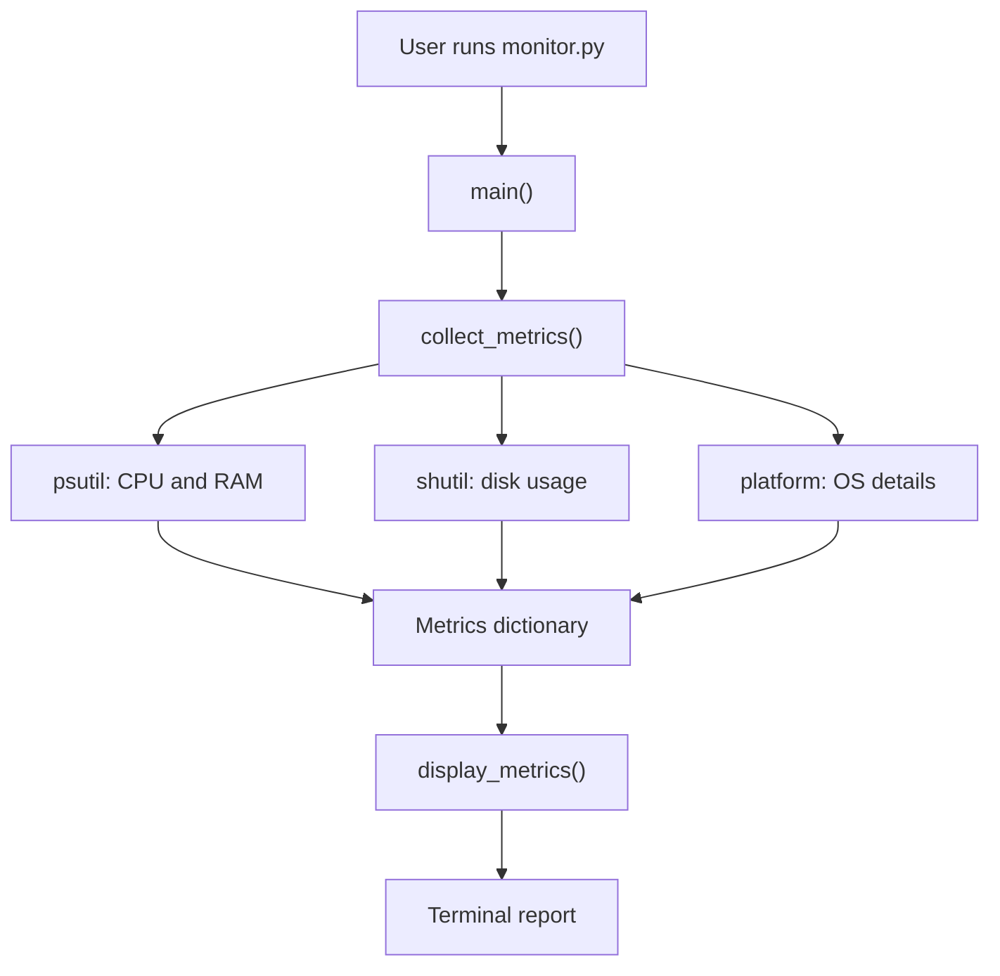

# ✦ Linux System Monitor

> A lightweight Python tool to inspect CPU, memory and disk usage from your terminal.


A small systems-monitoring project built to practise Python, Linux fundamentals, dependency management and CI automation. The visual identity is intentionally soft; the implementation stays focused on readable, maintainable code.

## Features

- CPU usage percentage
- RAM usage and available memory
- Disk usage and free space for the root filesystem
- Human-readable output in the terminal
- Automated tests and GitHub Actions checks

## Architecture

The script collects a one-time snapshot, normalises the values in a dictionary, then formats the result for terminal output.



## Preview

Run the script to display a snapshot of your machine's current resource usage.

## Requirements

- Python 3.10 or newer
- Linux or macOS
- `psutil`

## Installation

```bash
git clone https://github.com/johannafoolchand/linux-system-monitor.git
cd linux-system-monitor
python3 -m venv .venv
source .venv/bin/activate
python -m pip install -r requirements.txt
```

## Usage

```bash
python monitor.py
```

## Run the tests

```bash
python -m unittest discover -s tests -v
```

## Project structure

```text
linux-system-monitor/
├── .github/
│   └── workflows/
│       └── tests.yml
├── tests/
│   └── test_monitor.py
├── .gitignore
├── monitor.py
├── requirements.txt
└── README.md
```

## What I practised

- Collecting system metrics with Python and `psutil`
- Working with CPU, memory and disk information
- Organising code into reusable functions
- Writing unit tests with mocks
- Automating checks with GitHub Actions

## Roadmap

- [ ] Add a continuous refresh mode
- [ ] Add configurable warning thresholds
- [ ] Export metrics to JSON
- [ ] Package the tool for easier installation

---

Made with care by [Johanna Foolchand](https://github.com/johannafoolchand).
